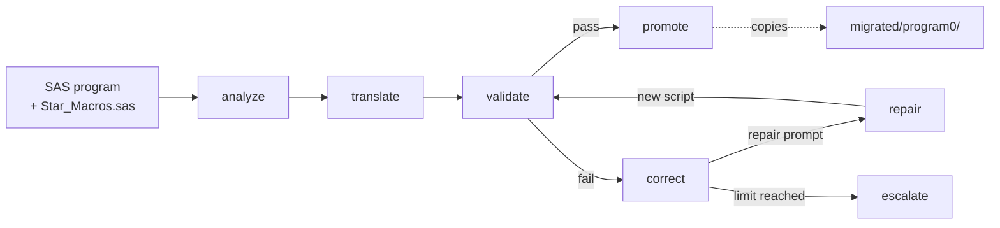

# SAS → Python Translation Agent: Student Guide

This guide explains the AI agent in this folder: what it does, how it is built with LangChain and
LangGraph, how to run it, and how to read the files it produces. You don't need to know SAS to follow
along, but you should be comfortable with Python and the terminal.

---

## Contents

1. [What the agent does](#1-what-the-agent-does)
2. [Key concepts](#2-key-concepts)
3. [Folder map](#3-folder-map)
4. [Setup](#4-setup)
5. [Running the agent](#5-running-the-agent)
6. [How it works, step by step](#6-how-it-works-step-by-step)
7. [The prompts](#7-the-prompts)
8. [The artifacts it produces](#8-the-artifacts-it-produces)
9. [Running and checking the translated code](#9-running-and-checking-the-translated-code)
10. [Customizing the agent](#10-customizing-the-agent)
11. [Troubleshooting](#11-troubleshooting)
12. [Limitations and next steps](#12-limitations-and-next-steps)

---

## 1. What the agent does

The project's goal is to migrate the CMS Hospital Star Rating pipeline from SAS to Python. The
pipeline lives in `data/Project_1/SAS Programs/` and has three programs that run in order, plus a
shared macro file:

| Program | What it does | Writes |
|---|---|---|
| `0 - Data and Measure Standardization_2025Jul.sas` | Cleans the hospital data and converts each measure to a Z-score | `STD_DATA_2025JUL_ANALYSIS`, `MEASURE_AVERAGE_STDDEV_2025JUL`, `LESS100_MEASURE` |
| `1 - First stage_Simple Average of Measure Scores_2025Jul.sas` | Averages measures into 5 group scores | `OUTCOME_MORTALITY`, `OUTCOME_SAFETY`, `OUTCOME_READMISSION`, `PTEXP`, `PROCESS` |
| `2 - Second Stage_Weighted Average and Categorize Star_2025Jul.sas` | Weights group scores into a summary score and assigns stars (k-means) | `STAR_2025JUL`, `NATIONAL_AVERAGE_2025JUL` |
| `Star_Macros.sas` | Reusable macros used by all three programs | — |

For each program, the agent starts with two steps that use a Gemini model:

1. **Analyze**: reads the SAS code and writes a plain-language explanation and translation plan.
2. **Translate**: uses that plan to write a complete, runnable Python (pandas) script.

It can then stop, or keep going until the script matches SAS. There are two modes:

| Mode | Command | What happens after translate |
|---|---|---|
| **Baseline** (single pass) | `python -m sas_agent` | Nothing: the script is saved. We keep this mode to measure what the fix loop adds. |
| **Fix loop** | `python -m sas_agent --fix-loop` | The **Validation agent** checks, runs, and compares the script with the SAS outputs. If anything fails, the **Correction agent** writes repair instructions and the translator's model writes a whole new script, up to 3 times. A script that passes is copied to `migrated/`. |



Every attempt is kept under `runs/<run-id>/` (see [section 8](#8-the-artifacts-it-produces)).
`migrated/` only ever holds translations that **passed** the comparison.

> **The other agents live on other branches for now.** The fix loop calls the Validation agent
> (`validation_agent/`, branch `validation_agent`) and the Correction agent (`correction_agent/` and
> `sas_agent/prompts/fix.md`, branch `feature/correction_agent`) through the interfaces in
> `sas_agent/agents.py`. Until those branches are merged, `--fix-loop` stops with a message naming the
> branch that is missing. The baseline mode works now.

---

## 2. Key concepts

**LLM (Large Language Model).** A model such as Gemini that takes text in (a *prompt*) and produces
text out. We use it to read SAS and write Python.

**Prompt.** The instructions and data we send to the LLM. A *system prompt* sets the model's role
and rules; a *user prompt* contains the specific task. This agent stores each prompt in its own
Markdown file (see [section 7](#7-the-prompts)).

**LangChain.** A Python library that gives every LLM provider the same interface. We call
`init_chat_model("google_genai:gemini-3.8-flash")` and get an object with an `.invoke(messages)`
method. Switching to another provider means changing that string, not rewriting code.

**LangGraph.** A library for building workflows out of steps. Its main ideas:

| Idea | Meaning | In this agent |
|---|---|---|
| **State** | A dictionary passed from step to step | `MigrationState`: program id, analysis text, generated code… |
| **Node** | A Python function that reads the state and returns updates to it | `analyze`, `translate`, `save` (baseline); `validate`, `correct`, `repair`, `promote`, `escalate` (fix loop) |
| **Edge** | Which node runs next | `START → analyze → translate → save → END` (baseline) |
| **Graph** | Nodes + edges, compiled into an app you can run | `build_graph()` in `graph.py` |

**`StateGraph`: the class that ties it together.** In LangGraph, you build a workflow with the
`StateGraph` class. You give it the *shape* of the state (a `TypedDict`), add nodes and edges, and
call `.compile()` to get an app you can `.invoke()` or `.stream()`. This is the baseline workflow,
from `build_graph()` in `graph.py`:

```python
graph = StateGraph(MigrationState)        # a graph whose state looks like MigrationState
graph.add_node("analyze", analyze)        # nodes: plain Python functions
graph.add_node("translate", translate)
graph.add_node("save", save)
graph.add_edge(START, "analyze")          # edges: what runs next
graph.add_edge("analyze", "translate")
graph.add_edge("translate", "save")
graph.add_edge("save", END)
app = graph.compile()                     # a runnable app
```

Each node returns **only the keys it changes**, and LangGraph merges them into the shared state.
That's how `translate` can read `state["analysis"]` even though `analyze` produced it:

| After node | State contains |
|---|---|
| (start) | `program_id`, `prior_code` |
| `analyze` returns `{"analysis": ...}` | + `analysis` |
| `translate` returns `{"code": ...}` | + `code` |
| `save` returns `{"output_dir": ...}` | + `output_dir` |

Edges don't have to be fixed. A **conditional edge** picks the next node from the state, which is
how the fix loop is built. Every node in the loop returns an `event` (for example `"VALID_FAIL"`),
and `route()` looks up the next node in one table, `TRANSITIONS` in `graph.py`:

```python
TRANSITIONS = {
    ("validate", "VALID_PASS"): "promote",
    ("validate", "VALID_FAIL"): "correct",
    ...
}
graph.add_conditional_edges("validate", partial(route, "validate"), ["correct", "promote"])
```

Keeping every routing decision in one table means you can read the whole loop in one place, and an
event the table doesn't expect raises an error instead of silently going somewhere wrong.

> **`StateGraph` vs. `create_agent`.** LangChain also offers `create_agent`, a prebuilt loop in
> which the model decides which tools to call and when to stop. We use `StateGraph` because our
> steps always run in the same order, so a fixed graph is cheaper, more predictable, and easier
> to debug.

**Why an "agent" and not one big prompt?** Splitting the work into steps makes each step simpler
for the model (plan first, then code), produces an analysis you can review, and makes it easy to
add more steps later, such as running the code and fixing errors.

---

## 3. Folder map

```
sas_agent/
├── __init__.py
├── __main__.py             # command-line entry point: python -m sas_agent ...
├── config.py               # paths, model name, list of SAS programs, fix-loop limits
├── graph.py                # the LangGraph workflows (baseline and fix loop)
├── agents.py               # how the graph calls the Validation, Correction, and Translator agents
├── runs.py                 # creates the run folders under runs/
├── README.md               # this guide
└── prompts/
    ├── __init__.py         # loads the .md prompt files
    ├── system.md           # system prompt (role + SAS rules), used by every LLM step
    ├── runtime_contract.md # rules the generated Python must follow
    ├── analyze.md          # task prompt for the analyze node
    ├── translate.md        # task prompt for the translate node
    └── fix.md              # (Correction agent's branch) its diagnosis prompt

tests/                      # run with: uv run pytest

runs/                       # created by the agent; every attempt; ignored by Git
└── <run-id>/
    ├── inputs/             # the input data, as the scripts read it
    └── program0/
        ├── analysis.md
        └── attempt-1/ ...  # see section 8.3

migrated/                   # translations that passed the comparison; committed to Git
└── program0/
    ├── analysis.md
    ├── program0.py
    └── provenance.json     # which run, attempt, model, and prompts produced it
```

Other files the agent depends on:

| File | Purpose |
|---|---|
| `pyproject.toml`, `uv.lock` | Python packages for the agent (managed with uv) |
| `requirements.txt` | The same packages for pip users, generated from `uv.lock` |
| `.env` | Your API key (private, never committed) |
| `data/Project_1/SAS Programs/*.sas` | The SAS code being translated |
| `data/Project_1/SAS Output/*.sas7bdat` | The SAS results the Validation agent checks against |

---

## 4. Setup

### 4.1 Install the packages

From the repository root, with [uv](https://docs.astral.sh/uv/):

```bash
uv sync
```

This creates `.venv/` with Python 3.12 and every package in `uv.lock`. Run commands with
`uv run ...` (for example `uv run python -m sas_agent`), or activate `.venv` first. Without uv,
`pip install -r requirements.txt` in a Python 3.12 environment installs the same versions.

| Package | Why |
|---|---|
| `langgraph` | Builds and runs the workflow graph |
| `langchain` | Provides `init_chat_model`, one interface for all LLM providers |
| `langchain-google-genai` | The Gemini connector for LangChain |
| `python-dotenv` | Loads your API key from the `.env` file |
| `pandas`, `numpy` | Used by the generated scripts |
| `pyreadstat` | Reads the SAS `.sas7bdat` files |
| `pytest` (development) | Runs the tests in `tests/` |

To add a package, use `uv add <package>` (or `uv add --dev <package>`), then regenerate
`requirements.txt` with `uv export --no-hashes --format requirements-txt -o requirements.txt`.

### 4.2 Add your Gemini API key

1. Get a key at <https://aistudio.google.com/apikey>.
2. Create a file named `.env` in the **repository root** (next to the main `README.md`) by copying
   the template, `cp .env_template .env`, then fill in your key:

   ```bash
   # .env
   GOOGLE_API_KEY=your-key-here
   # optional: choose a different model
   # SAS_AGENT_MODEL=google_genai:gemini-3.8-flash
   ```

3. Save it. `config.py` loads this file automatically when the agent starts.

> ⚠️ **Never commit your key.** `.env` is listed in `.gitignore`, so Git ignores it. Don't paste
> your key into code, notebooks, or chat. If a key is ever leaked, revoke it in Google AI Studio and
> create a new one.

**Alternative for Codespaces:** store the key as a Codespaces secret named `GOOGLE_API_KEY`
(GitHub → Settings → Codespaces → Secrets), then restart the Codespace. A key set in the environment
takes priority over `.env`.

---

## 5. Running the agent

Always run from the **repository root**, using `python -m`. Running a file directly
(`python sas_agent/graph.py`) won't work, because the package uses relative imports.

```bash
python -m sas_agent program0              # baseline: translate program 0 only
python -m sas_agent                       # baseline: translate all three, in order
python -m sas_agent --fix-loop program0   # fix loop: translate, validate, correct, repair
```

You choose programs by **ID**, not by file name. The IDs are defined in `config.py`:

| ID | SAS file |
|---|---|
| `program0` | `0 - Data and Measure Standardization_2025Jul.sas` |
| `program1` | `1 - First stage_Simple Average of Measure Scores_2025Jul.sas` |
| `program2` | `2 - Second Stage_Weighted Average and Categorize Star_2025Jul.sas` |

**What you'll see** (each model step can take a few minutes). A fix-loop run that needed one
correction looks like this:

```
=== Translating program0 with google_genai:gemini-3.8-flash (run 20261029-142501-3fa2) ===
[program0] finished node: analyze
[program0] finished node: translate
[program0] finished node: validate
[program0] finished node: correct
[program0] finished node: repair
[program0] finished node: validate
[program0] finished node: promote
[program0] PASSED at attempt 2 -> .../migrated/program0
Run records: .../runs/20261029-142501-3fa2
```

The last status is `PASSED` (the script matched SAS and was copied to `migrated/`), `ESCALATED`
(the limits were reached; see `escalation.json` in the run folder), or `BASELINE` (baseline mode).

**Why order matters:** in SAS, all three programs run in one session, so program 1 can use variables
that program 0 created. Our Python scripts run separately, so when translating program 1 the agent
includes the Python of earlier programs in the prompt as context: from this run, or else the
promoted copy in `migrated/`. Translate program 0 first. In fix-loop mode, if a program is
escalated, the run stops there, because later programs depend on it.

**Nothing is overwritten.** Every run gets a new folder under `runs/`, named by date, time, and a
random suffix. LLM output varies from run to run, so two runs can give different translations, and
you can compare them side by side.

---

## 6. How it works, step by step

All of this is in `graph.py`.

### 6.1 The state

The main fields (the full list, with comments, is in `graph.py`):

```python
class MigrationState(TypedDict, total=False):
    program_id: str              # e.g. "program0"         (provided by __main__.py)
    run_id: str                  # names the folder under runs/   (provided by __main__.py)
    prior_code: dict[str, str]   # earlier programs' Python (provided by __main__.py)
    analysis: str                # filled in by analyze
    code: str                    # the current script: from translate, then from repair
    attempt: int                 # 1 for the first translation, +1 per correction
    event: str                   # what the last node reported; route() reads it
    fix_request: dict            # what went wrong with the current attempt
    status: str                  # at the end: "PASSED", "ESCALATED", or "BASELINE"
    output_dir: str              # where the result is
```

Each node returns a small dictionary, and LangGraph merges it into the state for the next node.

> **Privacy rule.** The state never holds data values: no DataFrames, no error messages, no full
> comparison reports. Everything in it may be sent to the model. Data stays in files under
> `runs/<run-id>/.../data/`.

### 6.2 Building the prompt context

Before calling the LLM, both nodes call `ctx(state)`, which gathers:

| Key | Content |
|---|---|
| `sas_file` | The SAS file name |
| `sas_code` | The full SAS program text |
| `macros` | The full text of `Star_Macros.sas` (every program `%INCLUDE`s it) |
| `contract` | `runtime_contract.md`, with this program's required outputs filled in |
| `prior` | Python code of earlier programs (empty for `program0`) |

These values fill the `{placeholders}` in the prompt files.

### 6.3 The nodes

| Node | Mode | Uses the LLM? | What it does |
|---|---|---|---|
| `analyze` | both | ✅ | Sends `system.md` + `analyze.md` to Gemini, then **immediately** writes `analysis.md` |
| `translate` | both | ✅ | Sends `system.md` + `translate.md`, extracts the ` ```python ` block, and saves it as attempt 1 |
| `save` | baseline | ❌ | Ends the baseline run |
| `validate` | fix loop | via the agent | Hands the script to the Validation agent (see 6.6) and keeps only its redacted verdict: `next_state`, `rank`, `fix_request` |
| `correct` | fix loop | via the agent | Applies the limits, then asks the Correction agent for a repair prompt |
| `repair` | fix loop | ✅ | Sends the repair prompt to the translator's model and saves the whole new script as the next attempt |
| `promote` | fix loop | ❌ | Copies a passing script and its analysis to `migrated/<program>/`, with `provenance.json` |
| `escalate` | fix loop | ❌ | Ends the run when a limit is reached, keeping the best attempt and writing `escalation.json` |

`analysis.md` is written inside `analyze`, so you can read it while `translate` is still running,
and it is kept even if `translate` fails.

### 6.4 The fix loop's limits

The `correct` node stops the loop (→ `escalate`) when either limit in `config.py` is reached:

- `MAX_CORRECTIONS = 3`: at most three corrected scripts per program.
- `MAX_NO_IMPROVEMENT = 2`: two corrections in a row that don't improve on the best attempt so far.

Attempts are compared by the Validation agent's `rank` (lower is better): how far the script got,
then how many checks failed and how large the differences were. If a correction makes things worse,
it is rejected and the next correction starts from the best attempt.

If the model answers without a ` ```python ` block, the run escalates instead of crashing.

### 6.5 Calling the model safely

`_ask()` sends the messages and checks the model's `finish_reason`:

- `SAFETY`, `RECITATION`, … → raises an error (the response was blocked).
- `MAX_TOKENS` → raises an error (the response was cut off).

`extract_python()` pulls the code out of the reply. If there is no ` ```python ` block, it raises
`Model response contained no ```python code block`.

### 6.6 The other agents

The graph calls the other agents through `sas_agent/agents.py` and never imports them at the top of a
file, so it runs (and its tests pass) without them.

| Agent | Called by | What the graph uses |
|---|---|---|
| Validation agent (`validation_agent/`) | `validate` | `next_state` (`PASSED` or `TRIAGED`), `rank`, `fix_request` |
| Correction agent (`correction_agent/`) | `correct` | `repair_prompt` |
| Translator | `repair` | the new script; until the Translator is packaged, `llm_repairer()` in `graph.py` sends the repair prompt to the translator's model |

The Validation agent runs each script in a separate process with only `PATH`, `SAS_INPUT_DIR`, and
`SAS_OUTPUT_DIR` set, so your `GOOGLE_API_KEY` never reaches generated code. The models never see an
error message, because messages can contain data (for example `KeyError: '010001'`, a hospital ID).

---

## 7. The prompts

Every prompt is a Markdown file in `sas_agent/prompts/`, so you can improve the agent without
touching Python code.

| File | Sent as | Used by | Purpose |
|---|---|---|---|
| `system.md` | System message | every LLM node | Gives the model its role (SAS + pandas expert) and lists SAS behaviors that differ from pandas: missing values, sample standard deviation, MERGE, PROC FASTCLUS, … |
| `runtime_contract.md` | Inserted as `{contract}` | every LLM node | Rules the generated script must follow: read input from `SAS_INPUT_DIR`, write `<UPPERCASE_NAME>.csv` to `SAS_OUTPUT_DIR`, keep `PROVIDER_ID` as a string, read CSVs with `float_precision="round_trip"`, use only pandas, numpy, and the standard library, don't print data values |
| `analyze.md` | User message | `analyze` | Asks for the 5-section analysis (see [8.1](#81-analysismd-output-of-analyze)) |
| `translate.md` | User message | `translate` | Asks for one complete script: one function per SAS step, a `main()`, comments that point back to the SAS |
| `fix.md` | User message | Correction agent | **On the Correction agent's branch.** Asks for prose repair instructions (never code), given the failed script and the redacted validation feedback |

**Placeholders.** Text in `{curly_braces}` is replaced by `str.format()` at runtime. Keep the
placeholder names exactly as they are. If you need a literal brace in a prompt, write it doubled:
`{{` or `}}`.

| Placeholder | Filled with | Appears in |
|---|---|---|
| `{sas_file}`, `{sas_code}` | SAS file name and contents | `analyze.md`, `translate.md`, `fix.md` |
| `{macros}` | `Star_Macros.sas` contents | `analyze.md`, `translate.md`, `fix.md` |
| `{contract}` | Rendered `runtime_contract.md` | `analyze.md`, `translate.md`, `fix.md` |
| `{prior}` | Earlier programs' Python | `analyze.md`, `translate.md`, `fix.md` |
| `{analysis}` | Output of `analyze` | `translate.md`, `fix.md` |
| `{code}` | The script to correct (the best attempt so far, if the last one was worse) | `fix.md` |
| `{fix_request}` | The Validation agent's redacted description of what went wrong | `fix.md` |
| `{history}` | Earlier attempts' ranks | `fix.md` |
| `{outputs}` | This program's output datasets | `runtime_contract.md` |

---

## 8. The artifacts it produces

### 8.1 `analysis.md`: output of `analyze`

A Markdown document that explains the SAS program before any Python exists. It always has five
sections:

| Section | What to look for |
|---|---|
| **1. Purpose** | What the program computes, in business terms |
| **2. Inputs and outputs** | Datasets read and written, with key columns |
| **3. Step-by-step logic** | Each DATA step / PROC / macro call in order, with the pandas equivalent |
| **4. Macros and macro variables** | What each SAS macro becomes in Python |
| **5. Translation risks** | SAS details that are easy to get wrong in this program |

**How to use it:**
- Read it to learn what the SAS program does. It's often easier than reading the SAS.
- **Check its claims against the data.** For program 0, the analysis said the output keeps a
  `Total_m_cnt` column and that PROC MEANS writes 5 rows (`N, MIN, MAX, MEAN, STD`). Both are
  true, and you can confirm them by opening `data/Project_1/SAS Output CSV/`.
- Pay most attention to *Translation risks*. Those are the first places to look if the Python output
  doesn't match SAS.

It is saved as `runs/<run-id>/<program>/analysis.md`, and copied to `migrated/<program>/analysis.md`
when the program passes.

### 8.2 The script: output of `translate` and `repair`

A standalone Python script, saved as `runs/<run-id>/<program>/attempt-<n>/ai/script.py`. A script
that passes the comparison is copied to `migrated/<program>/<program>.py`. For program 0, it is
organized roughly like this:

| Part | SAS equivalent |
|---|---|
| `MEASURE_ALL_SPEC` and domain lists at the top | `%LET measure_all = ...` and the measure-group DATA steps |
| `keep_hos()` | The `%keep_hos` macro |
| `load_all_data()` | `DATA All_data_2025Jul; set HC.Alldata_2025Jul;` |
| `compute_measure_volume()` | `PROC TABULATE` + `PROC TRANSPOSE` |
| `build_less100_and_include_measures()` | The `less100_measure` / `include_measure` DATA steps |
| `compute_proc_means_default()` | `PROC MEANS ... output out=` |
| `standardize_and_redirect_measures()` | `PROC STANDARD` + the sign-flip DATA step |
| `main()` | Runs everything and writes the CSVs |

> Function names change from run to run, because the model writes them fresh each time. Treat the
> table as an example, not a fixed API.

### 8.3 The run folder

```
runs/<run-id>/
├── inputs/alldata_2025jul.csv     # written from the .sas7bdat file, so scripts see exactly what SAS read
└── program0/
    ├── analysis.md
    ├── escalation.json            # only if the run was escalated
    └── attempt-1/
        ├── ai/                    # what the model may see
        │   ├── script.py
        │   ├── repair_prompt.md   # attempts 2+: the Correction agent's prompt that produced this script
        │   ├── based_on.json      # attempts 2+: which earlier attempt it repaired
        │   └── validation.json    # the Validation agent's redacted result
        └── data/                  # written by the Validation agent; never sent to a model
            ├── outputs/*.csv      # what the script wrote
            └── stdout.txt, stderr.txt (full traceback), exception.json
```

`runs/` is ignored by Git. To keep a translation, use the fix loop: a passing translation is copied
to `migrated/` with `provenance.json`, and that is what gets committed.

> **Never edit files in `migrated/` by hand.** Later programs receive them as context in the
> prompt, so a hand edit would put human-written code into what should be the model's work.
> `provenance.json` records a hash of the script, so an edit can be detected.

---

## 9. Running and checking the translated code

In fix-loop mode the agent does this for you. This section is for running and checking a script by
hand, for example one from a baseline run.

### 9.1 Run it

The generated script reads two environment variables (from `runtime_contract.md`):

| Variable | Meaning | Value |
|---|---|---|
| `SAS_INPUT_DIR` | Folder with `alldata_2025jul.csv` | `runs/<run-id>/inputs` from a fix-loop run, or `data/Project_1/Starrating` |
| `SAS_OUTPUT_DIR` | Where to write the CSV outputs | Any folder; use `/tmp` to keep the repo clean |

From the repository root (replace `<run-id>` with your run's folder name):

```bash
mkdir -p /tmp/sas_output
SAS_INPUT_DIR="data/Project_1/Starrating" \
SAS_OUTPUT_DIR="/tmp/sas_output" \
uv run python runs/<run-id>/program0/attempt-1/ai/script.py
```

The quotes matter, because some folder names in this repo contain spaces. Run this way, the script
also sees your `GOOGLE_API_KEY` if it is exported in your shell; the Validation agent never passes
it on.

### 9.2 Compare with SAS

The real SAS results are in `data/Project_1/SAS Output/` (`.sas7bdat`, full precision) and
`data/Project_1/SAS Output CSV/` (some columns rounded). The Validation agent compares with the
`.sas7bdat` files. A quick check in Python:

```python
import pandas as pd

name = "STD_DATA_2025JUL_ANALYSIS"
sas = pd.read_csv(f"data/Project_1/SAS Output CSV/{name}.csv", dtype={"PROVIDER_ID": str})
py  = pd.read_csv(f"/tmp/sas_output/{name}.csv", dtype={"PROVIDER_ID": str}, float_precision="round_trip")

print("rows:", len(sas), "vs", len(py))
print("missing columns:", set(sas.columns) - set(py.columns))

sas = sas.sort_values("PROVIDER_ID").reset_index(drop=True)
py = py.sort_values("PROVIDER_ID").reset_index(drop=True)
for col in sas.select_dtypes("number").columns.intersection(py.columns):
    diff = (sas[col] - py[col]).abs().max()
    if diff > 1e-6:
        print(f"{col}: max difference {diff}")
```

If something doesn't match, check the *Translation risks* in `analysis.md`. To improve the result,
change the prompts (talk to the translation team, who own them) and re-run the agent. Don't fix the
script by hand.

### 9.3 A real example: almost right is not right

When we tested a `program0.py` generated by `gemini-4-argon`, the **logic was correct**: after two
small fixes, all 4,566 rows and every numeric column matched SAS within 1e-6. But the script **did
not run as generated**, because of two small mistakes:

| Mistake | Symptom | Lesson |
|---|---|---|
| A typo in a variable name: `header_ cols = ...` | `SyntaxError` before anything runs | LLMs can make typos too. Always run the code. |
| Output saved as `STD_DATA_2025JUL_ANALYSIS.CSV` instead of `.csv` | Comparison fails with `FileNotFoundError`; Linux file names are case-sensitive | The model "over-applied" the *UPPERCASE* rule in `runtime_contract.md`. Precise prompts matter. |

This is why the fix loop exists. The Validation agent catches the typo before the script runs and
reports a wrongly named `STD_DATA_2025JUL_ANALYSIS.CSV` as a failed check; in both cases the
Correction agent and the translator's model produce a corrected script.

---

## 10. Customizing the agent

| I want to… | Edit |
|---|---|
| Improve the analysis (new section, more detail) | `prompts/analyze.md` |
| Change the coding style of the Python | `prompts/translate.md` |
| Teach the model a SAS rule it keeps getting wrong | `prompts/system.md` |
| Change how failures are diagnosed | `prompts/fix.md` (Correction agent) |
| Change how scripts read and write files | `prompts/runtime_contract.md` (keep it in step with the Validation agent's checks) |
| Use a different Gemini model | `SAS_AGENT_MODEL` in `.env`, or `MODEL` in `config.py` |
| Translate a new SAS program | Add a `SasProgram(...)` entry to `PROGRAMS` in `config.py` |
| Change the fix loop's limits | `MAX_CORRECTIONS`, `MAX_NO_IMPROVEMENT` in `config.py` |
| Change where artifacts are saved | `RUNS_DIR` (every attempt) and `MIGRATED_DIR` (passing translations) in `config.py` |
| Add a new step to the workflow | Add a node in `build_graph()` and its transitions to `TRANSITIONS` in `graph.py` |

The prompts are owned by the translation team; `graph.py`, `agents.py`, and the other harness
files by the orchestration subgroup; `validation_agent/` and `correction_agent/` by their authors. Check with the owner before changing someone else's file.

**Changing the model.** The default is `google_genai:gemini-3.8-flash` (fast, built for coding).
For deeper reasoning, try `google_genai:gemini-4-argon`. For a single run:

```bash
SAS_AGENT_MODEL=google_genai:gemini-4-argon python -m sas_agent program0
```

Current model codes are listed at <https://ai.google.dev/gemini-api/docs/models>.

**Adding a program:**

```python
SasProgram(
    "program3",                  # the ID you type on the command line
    "3 - My New Program.sas",    # file name inside data/Project_1/SAS Programs/
    ["MY_OUTPUT_DATASET"],       # datasets it writes to library R
),
```

**Adding a node (example idea).** A `review` node could ask the model to double-check the code
against the analysis:

```python
def review(state: MigrationState) -> dict:
    ...                                   # call _ask(...) with a new prompts/review.md
    return {"code": improved_code}

graph.add_node("review", review)
graph.add_edge("translate", "review")    # replaces translate → save
graph.add_edge("review", "save")
```

---

## 11. Troubleshooting

| Problem | Likely cause | Fix |
|---|---|---|
| `ModuleNotFoundError: No module named 'sas_agent'` | Not running from the repo root, or using `python sas_agent/...` | `cd` to the repo root and use `python -m sas_agent ...` |
| API key / authentication error | Key missing or still the placeholder | Check `.env` has `GOOGLE_API_KEY=...`; an old `export`ed key overrides `.env`, so try `unset GOOGLE_API_KEY` |
| `KeyError: Unknown program 'program_0'` | Wrong ID | Use `program0`, `program1`, or `program2` |
| `Model response contained no ```python code block` | The model answered without a code block | Re-run; `analysis.md` is already saved |
| `Model blocked the response` | Gemini's safety filter | Re-run, or try another model |
| `Model hit its output token limit` | The script was too long for one response | Try a model with a larger output limit |
| `The fix loop needs the other agents: ... is not on this branch` | The Validation or Correction agent's branch isn't merged here | Use baseline mode, or merge the named branch |
| `LANGSMITH_TRACING is set` | Tracing would send prompts and state to LangSmith | `unset LANGSMITH_TRACING` |
| No `migrated/` folder after a run | Only fix-loop translations that **pass** are copied there | Look in `runs/<run-id>/` |
| Status `ESCALATED` | The fix loop reached a limit | Read `runs/<run-id>/<program>/escalation.json` and each attempt's `ai/` folder |
| Generated script: `FileNotFoundError` | `SAS_INPUT_DIR` / `SAS_OUTPUT_DIR` not set | Set both variables, see [9.1](#91-run-it) |
| Generated script: `SyntaxError` | The model made a typo | The fix loop's Validation agent catches this; in baseline mode, re-run the agent (see [9.3](#93-a-real-example-almost-right-is-not-right)) |
| Comparison snippet can't find an output file | Script wrote `.CSV` instead of `.csv` | Run `ls "$SAS_OUTPUT_DIR"` and use the actual file name |

---

## 12. Limitations and next steps

**Current limitations**
- **The fix loop needs the other agents merged.** The Validation and Correction agents are on their
  own branches. The graph is tested with fake agents in `tests/test_graph.py`, and its calls were
  checked once against the real agents' code, but it has not yet run end to end with Gemini.
- **Whole programs only.** Each SAS program is translated in one piece. Translating smaller units
  (macros and groups of steps), with a Spec agent writing a checked specification for each, is
  planned for November.
- **Results vary.** The same input can produce different code on different runs.
- **The model can be confidently wrong.** Always check `analysis.md` against the SAS code and data,
  and test the Python output. Even a correct translation can fail on a typo (see
  [9.3](#93-a-real-example-almost-right-is-not-right)).
- **Program 2 is the hardest.** Its k-means step (PROC FASTCLUS) has specific SAS rules that a
  generic `sklearn.KMeans` wouldn't reproduce exactly, and scikit-learn isn't allowed anyway: the
  translation has to implement FASTCLUS's rules with numpy.

**Next steps**
1. ~~Run, check, and compare each script automatically.~~ Done by the Validation agent (`validate`).
2. ~~A loop that sends the failure back and retries.~~ Done (`correct` and `repair`, with the
   Correction agent).
3. Merge the agents' branches and run the fix loop end to end on Programs 0, 1, and 2.
4. Units, a Spec agent, and a scheduler across units.
5. A **document** node that writes final documentation for analysts.
