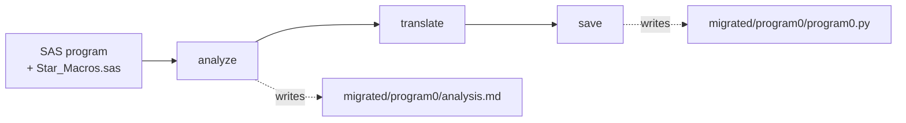

# SAS → Python Translation Agent: Student Guide

This guide explains the AI agent in this folder: what it does, how it is built with LangChain and
LangGraph, how to run it, and how to read the files it produces. You don't need to know SAS to follow
along, but you should be comfortable with Python and the terminal.

---

## Contents

1. [What the agent does](#1-what-the-agent-does)
2. [Key concepts](#2-key-concepts)
3. [Folder map](#3-folder-map)
4. [Setup](#4-setup)
5. [Running the agent](#5-running-the-agent)
6. [How it works, step by step](#6-how-it-works-step-by-step)
7. [The prompts](#7-the-prompts)
8. [The artifacts it produces](#8-the-artifacts-it-produces)
9. [Running and checking the translated code](#9-running-and-checking-the-translated-code)
10. [Customizing the agent](#10-customizing-the-agent)
11. [Troubleshooting](#11-troubleshooting)
12. [Limitations and next steps](#12-limitations-and-next-steps)

---

## 1. What the agent does

The project's goal is to migrate the CMS Hospital Star Rating pipeline from SAS to Python. The
pipeline lives in `data/Project_1/SAS Programs/` and has three programs that run in order, plus a
shared macro file:

| Program | What it does | Writes |
|---|---|---|
| `0 - Data and Measure Standardization_2025Jul.sas` | Cleans the hospital data and converts each measure to a Z-score | `STD_DATA_2025JUL_ANALYSIS`, `MEASURE_AVERAGE_STDDEV_2025JUL`, `LESS100_MEASURE` |
| `1 - First stage_Simple Average of Measure Scores_2025Jul.sas` | Averages measures into 5 group scores | `OUTCOME_MORTALITY`, `OUTCOME_SAFETY`, `OUTCOME_READMISSION`, `PTEXP`, `PROCESS` |
| `2 - Second Stage_Weighted Average and Categorize Star_2025Jul.sas` | Weights group scores into a summary score and assigns stars (k-means) | `STAR_2025JUL`, `NATIONAL_AVERAGE_2025JUL` |
| `Star_Macros.sas` | Reusable macros used by all three programs | — |

For each program, the agent does two things with a Gemini model:

1. **Analyze**: reads the SAS code and writes a plain-language explanation and translation plan.
2. **Translate**: uses that plan to write a complete, runnable Python (pandas) script.



> The agent **does not run** the Python it writes, and it does not check it against the SAS
> results. That is your job for now (see [section 9](#9-running-and-checking-the-translated-code)).

---

## 2. Key concepts

**LLM (Large Language Model).** A model such as Gemini that takes text in (a *prompt*) and produces
text out. We use it to read SAS and write Python.

**Prompt.** The instructions and data we send to the LLM. A *system prompt* sets the model's role
and rules; a *user prompt* contains the specific task. This agent stores each prompt in its own
Markdown file (see [section 7](#7-the-prompts)).

**LangChain.** A Python library that gives every LLM provider the same interface. We call
`init_chat_model("google_genai:gemini-3.8-flash")` and get an object with an `.invoke(messages)`
method. Switching to another provider means changing that string, not rewriting code.

**LangGraph.** A library for building workflows out of steps. Its main ideas:

| Idea | Meaning | In this agent |
|---|---|---|
| **State** | A dictionary passed from step to step | `MigrationState`: program id, analysis text, generated code… |
| **Node** | A Python function that reads the state and returns updates to it | `analyze`, `translate`, `save` |
| **Edge** | Which node runs next | `START → analyze → translate → save → END` |
| **Graph** | Nodes + edges, compiled into an app you can run | `build_graph()` in `graph.py` |

**`StateGraph`: the class that ties it together.** In LangGraph, you build a workflow with the
`StateGraph` class. You give it the *shape* of the state (a `TypedDict`), add nodes and edges, and
call `.compile()` to get an app you can `.invoke()` or `.stream()`. This is the whole workflow of
our agent, from `build_graph()` in `graph.py`:

```python
graph = StateGraph(MigrationState)        # a graph whose state looks like MigrationState
graph.add_node("analyze", analyze)        # nodes: plain Python functions
graph.add_node("translate", translate)
graph.add_node("save", save)
graph.add_edge(START, "analyze")          # edges: what runs next
graph.add_edge("analyze", "translate")
graph.add_edge("translate", "save")
graph.add_edge("save", END)
app = graph.compile()                     # a runnable app
```

Each node returns **only the keys it changes**, and LangGraph merges them into the shared state.
That's how `translate` can read `state["analysis"]` even though `analyze` produced it:

| After node | State contains |
|---|---|
| (start) | `program_id`, `prior_code` |
| `analyze` returns `{"analysis": ...}` | + `analysis` |
| `translate` returns `{"code": ...}` | + `code` |
| `save` returns `{"output_dir": ...}` | + `output_dir` |

Edges don't have to be fixed. A **conditional edge** picks the next node from the state, which is
how a future "run → validate → fix until it works" loop would be built:

```python
graph.add_conditional_edges("validate", lambda s: "save" if s["passed"] else "fix")
```

> **`StateGraph` vs. `create_agent`.** LangChain also offers `create_agent`, a prebuilt loop in
> which the model decides which tools to call and when to stop. We use `StateGraph` because our
> steps always run in the same order, so a fixed graph is cheaper, more predictable, and easier
> to debug.

**Why an "agent" and not one big prompt?** Splitting the work into steps makes each step simpler
for the model (plan first, then code), produces an analysis you can review, and makes it easy to
add more steps later, such as running the code and fixing errors.

---

## 3. Folder map

```
sas_agent/
├── __init__.py
├── __main__.py             # command-line entry point: python -m sas_agent ...
├── config.py               # paths, model name, list of SAS programs
├── graph.py                # the LangGraph workflow (nodes + edges)
├── README.md               # this guide
└── prompts/
    ├── __init__.py         # loads the .md prompt files
    ├── system.md           # system prompt (role + SAS rules), used by both nodes
    ├── runtime_contract.md # rules the generated Python must follow, used by both nodes
    ├── analyze.md          # task prompt for the analyze node
    └── translate.md        # task prompt for the translate node

migrated/                   # created by the agent (one folder per program)
└── program0/
    ├── analysis.md         # output of analyze
    └── program0.py         # output of translate
```

Other files the agent depends on:

| File | Purpose |
|---|---|
| `requirements.txt` | Python packages for the agent |
| `.env` | Your API key (private, never committed) |
| `data/Project_1/SAS Programs/*.sas` | The SAS code being translated |

---

## 4. Setup

### 4.1 Install the packages

From the repository root:

```bash
pip install -r requirements.txt
```

| Package | Why |
|---|---|
| `langgraph` | Builds and runs the workflow graph |
| `langchain` | Provides `init_chat_model`, one interface for all LLM providers |
| `langchain-google-genai` | The Gemini connector for LangChain |
| `python-dotenv` | Loads your API key from the `.env` file |

### 4.2 Add your Gemini API key

1. Get a key at <https://aistudio.google.com/apikey>.
2. Create a file named `.env` in the **repository root** (next to the main `README.md`) by copying
   the template, `cp .env_template .env`, then fill in your key:

   ```bash
   # .env
   GOOGLE_API_KEY=your-key-here
   # optional: choose a different model
   # SAS_AGENT_MODEL=google_genai:gemini-3.8-flash
   ```

3. Save it. `config.py` loads this file automatically when the agent starts.

> ⚠️ **Never commit your key.** `.env` is listed in `.gitignore`, so Git ignores it. Don't paste
> your key into code, notebooks, or chat. If a key is ever leaked, revoke it in Google AI Studio and
> create a new one.

**Alternative for Codespaces:** store the key as a Codespaces secret named `GOOGLE_API_KEY`
(GitHub → Settings → Codespaces → Secrets), then restart the Codespace. A key set in the environment
takes priority over `.env`.

---

## 5. Running the agent

Always run from the **repository root**, using `python -m`. Running a file directly
(`python sas_agent/graph.py`) won't work, because the package uses relative imports.

```bash
python -m sas_agent program0          # translate program 0 only
python -m sas_agent program1          # translate program 1 (run program0 first!)
python -m sas_agent                   # translate all three, in order
```

You choose programs by **ID**, not by file name. The IDs are defined in `config.py`:

| ID | SAS file |
|---|---|
| `program0` | `0 - Data and Measure Standardization_2025Jul.sas` |
| `program1` | `1 - First stage_Simple Average of Measure Scores_2025Jul.sas` |
| `program2` | `2 - Second Stage_Weighted Average and Categorize Star_2025Jul.sas` |

**What you'll see** (each step can take a few minutes):

```
=== Translating program0 with google_genai:gemini-3.8-flash ===
[program0] finished node: analyze
[program0] finished node: translate
[program0] finished node: save
[program0] wrote analysis.md and program0.py -> .../migrated/program0
```

**Why order matters:** in SAS, all three programs run in one session, so program 1 can use variables
that program 0 created. Our Python scripts run separately, so when translating program 1 the agent
includes the already-translated `program0.py` in the prompt as context. Translate program 0 first.

**Each run overwrites** that program's `analysis.md` and `.py`. LLM output varies from run to run,
so two runs can give different translations. Commit a version you like before re-running.

---

## 6. How it works, step by step

All of this is in `graph.py`.

### 6.1 The state

```python
class MigrationState(TypedDict, total=False):
    program_id: str              # e.g. "program0"   (you provide this)
    prior_code: dict[str, str]   # earlier programs' Python (provided by __main__.py)
    analysis: str                # filled in by analyze
    code: str                    # filled in by translate
    output_dir: str              # filled in by save
```

Each node returns a small dictionary, and LangGraph merges it into the state for the next node.

### 6.2 Building the prompt context

Before calling the LLM, both nodes call `ctx(state)`, which gathers:

| Key | Content |
|---|---|
| `sas_file` | The SAS file name |
| `sas_code` | The full SAS program text |
| `macros` | The full text of `Star_Macros.sas` (every program `%INCLUDE`s it) |
| `contract` | `runtime_contract.md`, with this program's required outputs filled in |
| `prior` | Python code of earlier programs (empty for `program0`) |

These values fill the `{placeholders}` in the prompt files.

### 6.3 The nodes

| Node | Uses the LLM? | Input | What it does | Output |
|---|---|---|---|---|
| `analyze` | ✅ | SAS code, macros, contract | Sends `system.md` + `analyze.md` to Gemini, then **immediately** writes `analysis.md` | `state["analysis"]` |
| `translate` | ✅ | Everything above **+ the analysis** | Sends `system.md` + `translate.md`, then extracts the ` ```python ` block from the reply | `state["code"]` |
| `save` | ❌ | `state["code"]` | Writes `<program>.py` | `state["output_dir"]` |

`analysis.md` is written inside `analyze` rather than in `save`, so you can read it while
`translate` is still running, and it is kept even if `translate` fails.

### 6.4 Calling the model safely

`_ask()` sends the messages and checks the model's `finish_reason`:

- `SAFETY`, `RECITATION`, … → raises an error (the response was blocked).
- `MAX_TOKENS` → raises an error (the response was cut off).

`extract_python()` pulls the code out of the reply. If there is no ` ```python ` block, it raises
`Model response contained no ```python code block`.

---

## 7. The prompts

Every prompt is a Markdown file in `sas_agent/prompts/`, so you can improve the agent without
touching Python code.

| File | Sent as | Used by | Purpose |
|---|---|---|---|
| `system.md` | System message | both nodes | Gives the model its role (SAS + pandas expert) and lists SAS behaviors that differ from pandas: missing values, sample standard deviation, MERGE, PROC FASTCLUS, … |
| `runtime_contract.md` | Inserted as `{contract}` | both nodes | Rules the generated script must follow: read input from `SAS_INPUT_DIR`, write `<UPPERCASE_NAME>.csv` to `SAS_OUTPUT_DIR`, keep `PROVIDER_ID` as a string, allowed libraries |
| `analyze.md` | User message | `analyze` | Asks for the 5-section analysis (see [8.1](#81-analysismd-output-of-analyze)) |
| `translate.md` | User message | `translate` | Asks for one complete script: one function per SAS step, a `main()`, comments that point back to the SAS |

**Placeholders.** Text in `{curly_braces}` is replaced by `str.format()` at runtime. Keep the
placeholder names exactly as they are. If you need a literal brace in a prompt, write it doubled:
`{{` or `}}`.

| Placeholder | Filled with | Appears in |
|---|---|---|
| `{sas_file}`, `{sas_code}` | SAS file name and contents | `analyze.md`, `translate.md` |
| `{macros}` | `Star_Macros.sas` contents | `analyze.md`, `translate.md` |
| `{contract}` | Rendered `runtime_contract.md` | `analyze.md`, `translate.md` |
| `{prior}` | Earlier programs' Python | `analyze.md`, `translate.md` |
| `{analysis}` | Output of `analyze` | `translate.md` |
| `{outputs}` | This program's output datasets | `runtime_contract.md` |

---

## 8. The artifacts it produces

### 8.1 `analysis.md`: output of `analyze`

A Markdown document that explains the SAS program before any Python exists. It always has five
sections:

| Section | What to look for |
|---|---|
| **1. Purpose** | What the program computes, in business terms |
| **2. Inputs and outputs** | Datasets read and written, with key columns |
| **3. Step-by-step logic** | Each DATA step / PROC / macro call in order, with the pandas equivalent |
| **4. Macros and macro variables** | What each SAS macro becomes in Python |
| **5. Translation risks** | SAS details that are easy to get wrong in this program |

**How to use it:**
- Read it to learn what the SAS program does. It's often easier than reading the SAS.
- **Check its claims against the data.** For program 0, the analysis said the output keeps a
  `Total_m_cnt` column and that PROC MEANS writes 5 rows (`N, MIN, MAX, MEAN, STD`). Both are
  true, and you can confirm them by opening `data/Project_1/SAS Output CSV/`.
- Pay most attention to *Translation risks*. Those are the first places to look if the Python output
  doesn't match SAS.

### 8.2 `<program>.py`: output of `translate`

A standalone Python script. For program 0, it is organized roughly like this:

| Part | SAS equivalent |
|---|---|
| `MEASURE_ALL_SPEC` and domain lists at the top | `%LET measure_all = ...` and the measure-group DATA steps |
| `keep_hos()` | The `%keep_hos` macro |
| `load_all_data()` | `DATA All_data_2025Jul; set HC.Alldata_2025Jul;` |
| `compute_measure_volume()` | `PROC TABULATE` + `PROC TRANSPOSE` |
| `build_less100_and_include_measures()` | The `less100_measure` / `include_measure` DATA steps |
| `compute_proc_means_default()` | `PROC MEANS ... output out=` |
| `standardize_and_redirect_measures()` | `PROC STANDARD` + the sign-flip DATA step |
| `main()` | Runs everything and writes the CSVs |

> Function names change from run to run, because the model writes them fresh each time. Treat the
> table as an example, not a fixed API.

---

## 9. Running and checking the translated code

### 9.1 Run it

The generated script reads two environment variables (from `runtime_contract.md`):

| Variable | Meaning | Value |
|---|---|---|
| `SAS_INPUT_DIR` | Folder with `alldata_2025jul.csv` | `data/Project_1/Starrating` |
| `SAS_OUTPUT_DIR` | Where to write the CSV outputs | Any folder; use `/tmp` to keep the repo clean |

From the repository root:

```bash
pip install pandas numpy        # the generated scripts need these
mkdir -p /tmp/sas_output
SAS_INPUT_DIR="data/Project_1/Starrating" \
SAS_OUTPUT_DIR="/tmp/sas_output" \
python migrated/program0/program0.py
```

The quotes matter, because some folder names in this repo contain spaces.

### 9.2 Compare with SAS

The real SAS results are in `data/Project_1/SAS Output CSV/`. A quick check in Python:

```python
import pandas as pd

name = "STD_DATA_2025JUL_ANALYSIS"
sas = pd.read_csv(f"data/Project_1/SAS Output CSV/{name}.csv", dtype={"PROVIDER_ID": str})
py  = pd.read_csv(f"/tmp/sas_output/{name}.csv",               dtype={"PROVIDER_ID": str})

print("rows:", len(sas), "vs", len(py))
print("missing columns:", set(sas.columns) - set(py.columns))

sas = sas.sort_values("PROVIDER_ID").reset_index(drop=True)
py = py.sort_values("PROVIDER_ID").reset_index(drop=True)
for col in sas.select_dtypes("number").columns.intersection(py.columns):
    diff = (sas[col] - py[col]).abs().max()
    if diff > 1e-6:
        print(f"{col}: max difference {diff}")
```

If something doesn't match, check the *Translation risks* in `analysis.md`, fix the prompt (usually
`system.md`), and re-run the agent.

### 9.3 A real example: almost right is not right

When we tested a `program0.py` generated by `gemini-4-argon`, the **logic was correct**: after two
small fixes, all 4,566 rows and every numeric column matched SAS within 1e-6. But the script **did
not run as generated**, because of two small mistakes:

| Mistake | Symptom | Lesson |
|---|---|---|
| A typo in a variable name: `header_ cols = ...` | `SyntaxError` before anything runs | LLMs can make typos too. Always run the code. |
| Output saved as `STD_DATA_2025JUL_ANALYSIS.CSV` instead of `.csv` | Comparison fails with `FileNotFoundError`; Linux file names are case-sensitive | The model "over-applied" the *UPPERCASE* rule in `runtime_contract.md`. Precise prompts matter. |

This is why the next milestone adds execute, validate, and fix steps to the agent.

---

## 10. Customizing the agent

| I want to… | Edit |
|---|---|
| Improve the analysis (new section, more detail) | `prompts/analyze.md` |
| Change the coding style of the Python | `prompts/translate.md` |
| Teach the model a SAS rule it keeps getting wrong | `prompts/system.md` |
| Change how scripts read and write files | `prompts/runtime_contract.md` |
| Use a different Gemini model | `SAS_AGENT_MODEL` in `.env`, or `MODEL` in `config.py` |
| Translate a new SAS program | Add a `SasProgram(...)` entry to `PROGRAMS` in `config.py` |
| Change where artifacts are saved | `MIGRATED_DIR` in `config.py` |
| Add a new step to the workflow | Add a node and edges in `build_graph()` in `graph.py` |

**Changing the model.** The default is `google_genai:gemini-3.8-flash` (fast, built for coding).
For deeper reasoning, try `google_genai:gemini-4-argon`. For a single run:

```bash
SAS_AGENT_MODEL=google_genai:gemini-4-argon python -m sas_agent program0
```

Current model codes are listed at <https://ai.google.dev/gemini-api/docs/models>.

**Adding a program:**

```python
SasProgram(
    "program3",                  # the ID you type on the command line
    "3 - My New Program.sas",    # file name inside data/Project_1/SAS Programs/
    ["MY_OUTPUT_DATASET"],       # datasets it writes to library R
),
```

**Adding a node (example idea).** A `review` node could ask the model to double-check the code
against the analysis:

```python
def review(state: MigrationState) -> dict:
    ...                                   # call _ask(...) with a new prompts/review.md
    return {"code": improved_code}

graph.add_node("review", review)
graph.add_edge("translate", "review")    # replaces translate → save
graph.add_edge("review", "save")
```

---

## 11. Troubleshooting

| Problem | Likely cause | Fix |
|---|---|---|
| `ModuleNotFoundError: No module named 'sas_agent'` | Not running from the repo root, or using `python sas_agent/...` | `cd` to the repo root and use `python -m sas_agent ...` |
| API key / authentication error | Key missing or still the placeholder | Check `.env` has `GOOGLE_API_KEY=...`; an old `export`ed key overrides `.env`, so try `unset GOOGLE_API_KEY` |
| `KeyError: Unknown program 'program_0'` | Wrong ID | Use `program0`, `program1`, or `program2` |
| `Model response contained no ```python code block` | The model answered without a code block | Re-run; `analysis.md` is already saved |
| `Model blocked the response` | Gemini's safety filter | Re-run, or try another model |
| `Model hit its output token limit` | The script was too long for one response | Try a model with a larger output limit |
| No `migrated/` folder after a run | The run failed before the first file was written | Read the error in the terminal |
| Generated script: `FileNotFoundError` | `SAS_INPUT_DIR` / `SAS_OUTPUT_DIR` not set | Set both variables, see [9.1](#91-run-it) |
| Generated script: `SyntaxError` | The model made a typo | Re-run the agent, or fix the line by hand (see [9.3](#93-a-real-example-almost-right-is-not-right)) |
| Comparison snippet can't find an output file | Script wrote `.CSV` instead of `.csv` | Run `ls "$SAS_OUTPUT_DIR"` and use the actual file name |

---

## 12. Limitations and next steps

**Current limitations**
- **No automatic testing.** The agent doesn't execute the generated code or compare it with SAS.
- **Results vary.** The same input can produce different code on different runs.
- **The model can be confidently wrong.** Always check `analysis.md` against the SAS code and data,
  and test the Python output. Even a correct translation can fail on a typo (see
  [9.3](#93-a-real-example-almost-right-is-not-right)).
- **Program 2 is the hardest.** Its k-means step (PROC FASTCLUS) has specific SAS rules that a
  generic `sklearn.KMeans` won't reproduce exactly.

**Ideas for the next milestone**
1. An **execute** node that runs the generated script automatically.
2. A **validate** node that compares outputs to `SAS Output CSV/` (like the snippet in
   [9.2](#92-compare-with-sas)).
3. A **fix** loop: if validation fails, send the error back to the model and retry. LangGraph's
   conditional edges (`add_conditional_edges`) make this loop easy to add.
4. A **document** node that writes final documentation for analysts.
